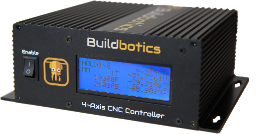
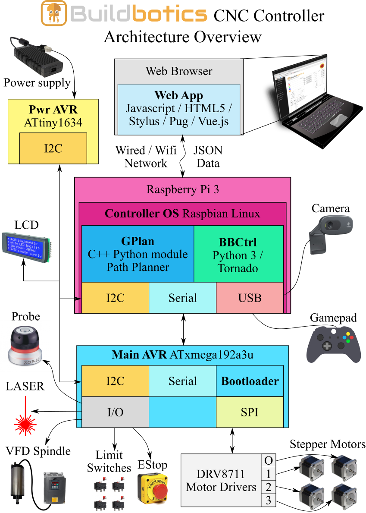

# RONtrol CNC Controller Firmware
Firmware and web UI for Buildbotics CNC Controllers, based on the
[Buildbotics firmware](https://github.com/buildbotics/bbctrl-firmware).  It
adds a restyled interface, dual-motor homing, and support for older
controllers that upstream 2.x firmware no longer runs on.  See
[buildbotics.com](https://buildbotics.com/) for the hardware.

## Supported Hardware
One firmware package and one SD card image run on all of these:

| Main board | Main AVR      | Power chip | Raspberry Pi |
|------------|---------------|------------|--------------|
| Rev 13 and earlier | ATxmega192A3U | ATtiny1634 | 3 or 4 |
| Rev 14 to 16       | ATxmega192A3U | ATtiny3216 | 3 or 4 |
| Rev 17 and later   | ATxmega256A3  | ATtiny3216 | 3 or 4 |

The revision is printed on the main board.  The controller detects which AVR
image to load and how to program it.  Rev 14 and 15 boards must be selected
under **Admin > Main Board**, or their motor drivers stay disabled.  Details
are in the [development guide](docs/development.md#supported-hardware).

## Installing
**New SD card.**  Build the 64-bit Debian 12 image with ``make image`` and
write it to a card; see
[Installing the RaspberryPi base system](docs/development.md#installing-the-raspberrypi-base-system).

**Controllers running 1.x firmware** use 32-bit Raspbian and cannot be
upgraded from their web UI.  Move them to a new SD card and keep the old one
as a fallback; see
[Moving a 1.x Controller](docs/development.md#moving-a-1x-controller).

**Updates.**  Controllers check this repository's
[GitHub Releases](https://github.com/alexpinson5/RONtrol-firmware/releases)
and offer an upgrade when a newer version is published.  **Admin > Firmware >
Upgrade** downloads it, checks its SHA-256 sum and installs it.  A package
built locally can be installed with **Admin > Firmware > Upload**.

## Overview

The diagram shows the original Pi 3 and ATtiny1634 design.  The main parts of
the controller software and the technologies they are built with are as
follows:

 * Web App - Frontend user interface
   * [Javascript](https://www.w3schools.com/js/)
   * [HTML5](https://www.w3schools.com/html/)
   * [Stylus](http://stylus-lang.com/)
   * [Pug.js](https://pugjs.org/)
   * [Vue.js](https://vuejs.org/)

 * Controller OS - Raspberry Pi Operating System
   * [Debian 12](https://www.debian.org/), 64-bit

 * BBCtrl - Python App
   * [Python 3](https://www.python.org/)
   * [Tornado Web](https://www.tornadoweb.org/)

 * CAMotics - Path Planner Python Module
   * [C++](http://www.cplusplus.com/)
   * [CAMotics](https://camotics.org/)

 * Main AVR Firmware + Bootloader - Real-time step generation, etc.
   * [ATxmega256A3](https://www.microchip.com/wwwproducts/ATxmega256A3) and
     [ATxmega192A3U](https://www.microchip.com/wwwproducts/ATxmega192A3U)
   * [C](https://en.wikipedia.org/wiki/C_(programming_language))

 * Pwr AVR Firmware - Power safety
   * [ATtiny3216](https://www.microchip.com/wwwproducts/ATtiny3216)
   * [C](https://en.wikipedia.org/wiki/C_(programming_language))

## Quickstart Guide

Be sure to read the [development guide](docs/development.md) for more detailed
instructions.

On a Debian Linux (12) system:

    # Install the required packages
    sudo apt-get update
    sudo apt-get install -y build-essential git wget binfmt-support \
      qemu-user-static parted gcc-avr avr-libc avrdude pylint python3 \
      python3-tornado curl unzip python3-setuptools nodejs coreutils bison \
      flex gcc-aarch64-linux-gnu gcc-arm-linux-gnueabihf mtools debootstrap

    # Get the source
    git clone https://github.com/alexpinson5/RONtrol-firmware

    # Build the Firmware
    cd RONtrol-firmware
    make pkg

    # Run the tests (setup in the development guide)
    make test

The resulting package will be a ``.tar.bz2`` file in ``dist``.  To publish it
as a release, see
[Publishing a Release](docs/development.md#publishing-a-release).

## License
Copyright (c) 2015 - 2026, Buildbotics LLC, All rights reserved.

This source describes Open Hardware and is licensed under the CERN-OHL-S v2

You may redistribute and modify this documentation and make products
using it under the terms of the CERN-OHL-S v2 (https:/cern.ch/cern-ohl).
This documentation is distributed WITHOUT ANY EXPRESS OR IMPLIED
WARRANTY, INCLUDING OF MERCHANTABILITY, SATISFACTORY QUALITY
AND FITNESS FOR A PARTICULAR PURPOSE. Please see the CERN-OHL-S v2
for applicable conditions.

Source location: https://github.com/buildbotics

As per CERN-OHL-S v2 section 4, should You produce hardware based on
these sources, You must maintain the Source Location clearly visible on
the external case of the CNC Controller or other product you make using
this documentation.
